# GRUPO DOS HERDEIROS DO TRONO DA GRANDE ESPADA DO LORD KAIZER

PokéTree: AVL vs Rubro-Negra

Entrega 2 (final) do trabalho da disciplina Estruturas de Dados II - UNICID
Prof. Cid Rodrigues de Andrade

## Integrantes do Grupo

| Nome completo | RA |
|---|---|
| Diogo Henrique Pinheiro da Silva Pedro | 43614442 |
| Pedro Henrique Segala | 43695469 |
| Marconio Soares de Sousa Junior | 43840868 |
| Bruno Oliveira Theodoro | 43023452 |
| Kauan Albas Elias | 43555829 |

---

## 1. Dataset

### 1.1 Descrição

Dataset de Pokémons individuais, gerado a partir de dados base reais da PokéAPI. Cada registro representa um Pokémon (espécie real) com atributos sorteados: gênero, variante shiny, 4 ataques e IV. Formato: CSV (`dataset/pokemon_dataset.csv`). Volume: **500.000 registros**, dentro da faixa exigida (10 mil a 10 milhões).

O dataset pode ser regerado com `make dataset` (script `dataset/gerar_dataset.py`, que usa `dataset/base_especies.csv` e não precisa de internet).

### 1.2 Fonte

* Dados base de espécies e movimentos: PokéAPI (https://pokeapi.co/)
* Registros individuais: gerados pelo grupo por amostragem aleatória dentro do espaço de combinações possíveis. Não é uma enumeração exaustiva de todas as combinações, que passaria de centenas de milhões

### 1.3 Estrutura dos dados

* id (int): identificador único e sequencial do registro, atribuído na geração do dataset; é o campo de desempate final da chave composta
* nome (string): nome da espécie do Pokémon (inclui formas regionais, ex.: "Raticate Alola")
* genero (string): "macho", "femea" ou "sem genero"
* shiny (bool): 0 ou 1
* ataque1 a ataque4 (strings): 4 golpes sorteados do conjunto de golpes que a espécie aprende
* ivs (int, 1 a 100): valor individual usado no cálculo de total_stats
* total_stats (int): ver cálculo e papel na chave composta em 1.3.1

### 1.3.1 Cálculo de total_stats

total_stats é derivado dos status base da espécie (HP, Ataque, Defesa, Ataque Especial, Defesa Especial e Velocidade, obtidos da PokéAPI) ajustados pelo IV do registro:

```
stat_final_i = status_base_i + (ivs * fator_escala)   // fator_escala = 0.5
total_stats  = soma dos 6 stat_final_i
```

### 1.3.2 Chave composta e comparador

A chave de inserção, busca e comparação nas árvores é composta:

```
chave = (total_stats, nome, id)
```

Comparador (ordem lexicográfica, nessa ordem de prioridade):

1. **total_stats** — critério principal; é o campo que o grupo quer observar em termos de distribuição e balanceamento.
2. **nome** — desempate quando dois registros têm o mesmo total_stats.
3. **id** — desempate final; como é único e sequencial, garante que a chave composta nunca tenha empate total, mesmo entre registros com mesmo total_stats e mesmo nome (ex.: dois Pikachu shiny com os mesmos stats).

Isso significa que inserção, busca e remoção por chave deixam de ser ambíguas mesmo com total_stats tendo só algumas centenas de valores possíveis para até 500 mil registros: o terceiro campo (id) sempre resolve o empate, e a altura da árvore passa a refletir corretamente o volume de dados inserido.

### 1.4 Justificativa da escolha

total_stats é um valor numérico com boa distribuição entre os registros, o que ajuda nos testes de balanceamento da AVL e da Rubro-Negra; nome e id complementam a chave garantindo unicidade sem distorcer essa distribuição. O volume de centenas de milhares de registros permite ver o comportamento das árvores em escala e comparar o crescimento real de tempo/altura com a complexidade teórica O(log n).

---

## 2. Estrutura(s) de Árvore Escolhida(s)

### 2.1 Estrutura(s)

* AVL
* Rubro-Negra

### 2.2 Justificativa técnica

As duas estruturas resolvem o problema de degeneração da BST simples, que pode virar uma lista encadeada quando os dados são inseridos em ordem. Mas cada uma tem um trade-off diferente:

* AVL: balanceamento estrito (fator de altura entre -1 e 1). Árvore mais baixa e buscas mais rápidas, com mais rotações em inserção/remoção
* Rubro-Negra: regras de balanceamento mais flexíveis, baseadas em cor dos nós. Menos rotações por operação de escrita, com altura um pouco maior

Escolhemos as duas pra comparar na prática o trade-off entre leitura e escrita.

### 2.3 Operações implementadas

Implementação em C (C11), sem bibliotecas externas, nas duas árvores:

* [x] Inserção (`avl_inserir` / `rn_inserir`)
* [x] Remoção (`avl_remover` / `rn_remover`)
* [x] Busca (`avl_buscar` / `rn_buscar`)
* [x] Percursos (pré-ordem, em ordem, pós-ordem)
* [x] Balanceamento (AVL: rotações simples e duplas; Rubro-Negra: rotações + recoloração, com sentinela NIL)
* [x] Outras: validação programática das invariantes (`avl_validar` / `rn_validar`), contagem de comparações, rotações e recolorações, estimativa de memória, e app gráfico com visualização do caminho de busca (bônus)

### 2.4 Complexidade

| Operação | Melhor caso | Caso médio | Pior caso |
|---|---|---|---|
| Inserção | O(log n) | O(log n) | O(log n) |
| Busca | O(log n) | O(log n) | O(log n) |
| Remoção | O(log n) | O(log n) | O(log n) |

AVL e Rubro-Negra garantem O(log n) no pior caso por serem auto-balanceadas. Já a BST simples degenera pra O(n) no pior caso.

---

## 3. Plano de Testes

### 3.1 Objetivo dos testes

Validar a corretude das operações (inserção, busca, remoção) e o balanceamento das árvores, e medir e comparar o desempenho (tempo, altura, rotações e memória) entre AVL e Rubro-Negra conforme o volume de dados cresce.

### 3.2 Cenários de teste

| Cenário | Entrada | Operação | Métricas registradas | Resultado esperado | Status |
|---|---|---|---|---|---|
| 1 | Inserir dataset completo em cada árvore | Inserção | Rotações e recolorações por inserção; tempo total | Todas as árvores mantêm as invariantes de balanceamento após a carga | ✅ |
| 2 | Buscas aleatórias em amostra representativa | Busca | Comparações por busca; tempo médio | Tempo médio de busca compatível com O(log n) | ✅ |
| 3 | Remoções em lote seguidas de validação de invariantes | Remoção | Rotações/recolorações por remoção; tempo total | Estrutura permanece válida (AVL: fator -1 a 1; RN: 5 regras de cor) | ✅ |

### 3.2.1 Metodologia de execução

* **Tamanhos de entrada testados:** 1.000 / 5.000 / 10.000 / 50.000 / 100.000 / 300.000 / 500.000 registros, inseridos em ordem progressiva pra observar o crescimento do tempo em cada faixa
* **Condições de medição:** todos os testes rodam na mesma máquina, logo após ligá-la, sem outros programas em segundo plano, pra minimizar ruído de medição
* **Aquecimento (warm-up):** a primeira execução de cada tamanho de entrada é descartada antes das 5 repetições, para reduzir efeitos de cache e de alocação de memória
* **Repetições por teste:** cada medição roda 5 vezes com o mesmo tamanho de entrada; o resultado reportado é a média e o desvio padrão das 5 execuções (evita que uma variação pontual da máquina distorça o gráfico)
* **Busca (Cenário 2):** amostra de 1.000 buscas aleatórias por rodada, metade com chaves existentes e metade com chaves inexistentes (pra testar também o caso de busca sem sucesso)
* **Remoção (Cenário 3):** remove-se 10% dos registros inseridos, escolhidos aleatoriamente, e as invariantes são checadas logo depois de cada lote de remoção (não só no final)
* **Ordem de inserção:** um teste com dados em ordem aleatória (caso médio/comum) e outro com dados em ordem crescente de total_stats (pior caso teórico pra uma BST simples), pra reforçar por que o balanceamento importa
* **Ferramenta de cronometragem:** `clock_gettime(CLOCK_MONOTONIC)` em C, medindo só o tempo da operação em si, sem contar a leitura do dataset (o CSV é carregado na memória antes de começar a medir)

### 3.3 Casos extremos (edge cases)

| # | Caso | Comportamento esperado |
|---|---|---|
| 1 | Árvore vazia | Busca e remoção retornam "não encontrado" sem lançar erro/exceção |
| 2 | Único elemento | Inserção, busca (encontra) e remoção (árvore volta a ficar vazia) funcionam sem exigir rotações em nenhuma das duas árvores |
| 3 | Dados com mesmo total_stats (e, eventualmente, mesmo nome) | Como a chave é composta (total_stats, nome, id) e id é sempre único, todos os registros entram sem colisão real, mesmo com 3+ registros de total_stats idêntico |
| 4 | Inserção em ordem crescente de total_stats | Pior caso teórico para uma BST simples (degenera em lista, O(n)); AVL deve manter altura ≈ 1,44 · log₂(n) e Rubro-Negra ≤ 2 · log₂(n), evitando a degeneração |
| 5 | Inserção em ordem decrescente de total_stats | Comportamento simétrico ao caso crescente, com as mesmas garantias de altura |
| 6 | Volume máximo do dataset (~500 mil registros) | Tempo de inserção/busca cresce conforme O(log n) (não linearmente); altura final respeita os mesmos limites teóricos dos casos 4 e 5 |
| 7 | Remover todos os elementos até a árvore ficar vazia de novo | Estado final consistente: árvore vazia, sem nós residuais, e sujeita ao comportamento do caso 1 |

### 3.4 Testes de desempenho

Todas as medições são feitas pelo programa `testes/teste_desempenho.c` (`make completo`), e os resultados ficam em [`resultados/resultados_desempenho.csv`](resultados/resultados_desempenho.csv).

* **Tamanhos de entrada:** 1.000, 5.000, 10.000, 50.000, 100.000, 300.000 e 500.000 registros, sempre os primeiros *n* registros do dataset real.
* **Ordens de inserção:** aleatória (caso médio), crescente e decrescente de chave (pior caso de uma BST simples).
* **Repetições:** 1 execução de aquecimento descartada + 5 repetições por combinação (árvore × ordem × n). O CSV guarda média e desvio padrão.
* **Mesma entrada para as duas árvores:** a semente do sorteio é fixa por (n, ordem), então AVL e Rubro-Negra recebem exatamente os mesmos dados, na mesma ordem.
* **Tempo:** `clock_gettime(CLOCK_MONOTONIC)`, medindo só as operações:
  * inserção: tempo total para inserir os *n* registros, e tempo médio por inserção;
  * busca: 1.000 buscas por rodada, metade com chaves existentes e metade com chaves inexistentes;
  * remoção: 10% dos registros, sorteados, e tempo médio por remoção.
* **Contadores:** comparações de chave por operação, rotações (AVL e RN), recolorações (RN) e altura final.
* **Memória:** estimada como `nº de nós × sizeof(nó)` (`NoAVL` = 256 bytes; `NoRN` = 264 bytes + 1 sentinela NIL). Não inclui o overhead interno do `malloc`.
* **Corretude:** depois de cada carga e de cada lote de remoções, as invariantes são validadas por código (`avl_validar` / `rn_validar`). Todas as combinações passaram (`invariantes_ok = 1` no CSV).

Os testes de corretude ficam em `testes/teste_corretude.c` (`make testes`): árvore vazia, elemento único, chaves com mesmo `total_stats` e mesmo nome, chave repetida, ordem crescente/decrescente, os três percursos, 60.000 inserções/remoções aleatórias misturadas, remoção até esvaziar (validando a cada remoção), 100.000 registros reais do dataset e um teste de "sabotagem", que corrompe a árvore de propósito para provar que os validadores detectam o erro.

### 3.5 Resultados obtidos

Resultados com inserção em **ordem aleatória** (médias de 5 repetições):

| n | Altura AVL | Altura RN | log₂(n) | Comparações/busca AVL | Comparações/busca RN | Inserção AVL (µs/op) | Inserção RN (µs/op) | Busca AVL (µs) | Busca RN (µs) | Rotações AVL | Rotações RN |
|---|---|---|---|---|---|---|---|---|---|---|---|
| 1.000 | 12 | 12 | 10,0 | 10,1 | 10,1 | 0,27 | 0,16 | 0,11 | 0,11 | 727 | 571 |
| 10.000 | 16 | 16 | 13,3 | 13,1 | 13,1 | 0,46 | 0,28 | 0,28 | 0,27 | 7.065 | 5.815 |
| 100.000 | 20 | 20 | 16,6 | 16,5 | 16,5 | 1,25 | 0,92 | 1,21 | 1,27 | 70.522 | 58.581 |
| 500.000 | 23 | 23 | 18,9 | 18,9 | 19,0 | 1,97 | 1,53 | 2,03 | 2,08 | 377.332 | 322.301 |

Inserção em **ordem crescente** (pior caso para uma BST simples):

| n | Altura AVL | Limite AVL (1,44·log₂ n) | Altura RN | Limite RN (2·log₂(n+1)) | Altura de uma BST simples |
|---|---|---|---|---|---|
| 10.000 | 14 | 19,1 | 24 | 26,6 | 10.000 |
| 100.000 | 17 | 23,9 | 31 | 33,2 | 100.000 |
| 500.000 | 19 | 27,3 | 35 | 37,9 | 500.000 |

Gráficos (gerados por `graficos/gerar_graficos.py` a partir do CSV):

**Tempo médio por operação × n**, comparado com c·log₂(n):

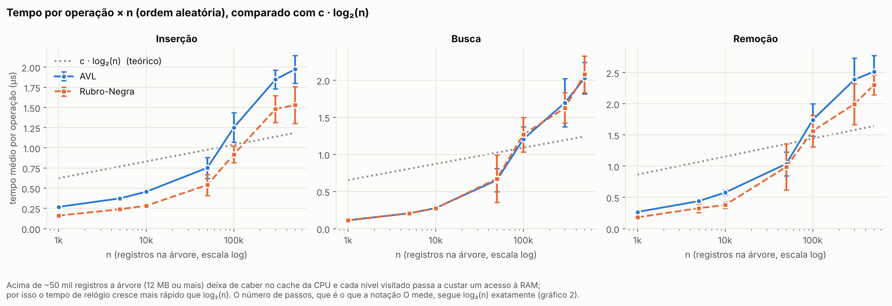

**Comparações de chave por busca × n**, comparado com log₂(n):

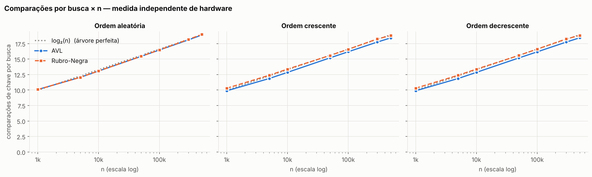

**Altura × n** nas três ordens de inserção, com os limites teóricos de cada árvore:

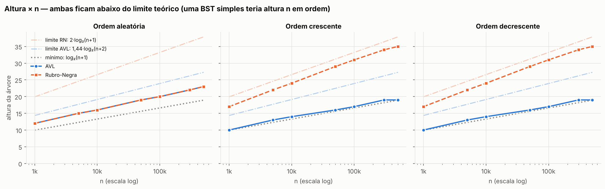

**Rotações** na inserção e na remoção:

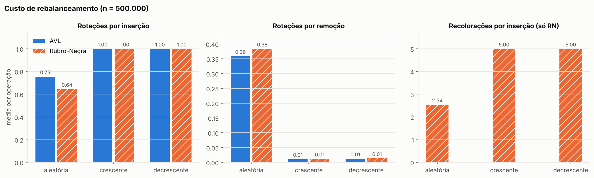

**Tempo total para inserir n registros** (log-log), comparado com n·log₂(n):

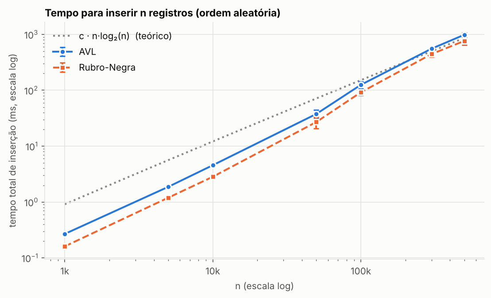

**Memória estimada × n:**

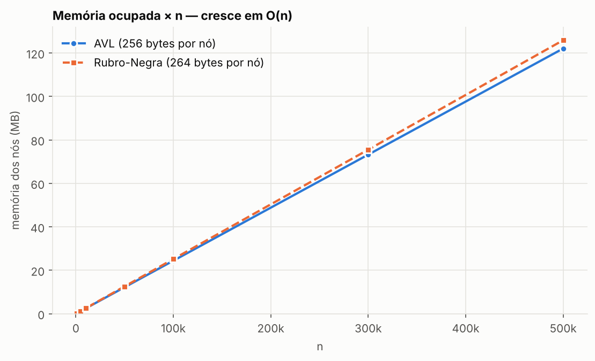

**Análise e comparação com o Big-O teórico:**

* **O(log n) confirmado no número de passos.** As comparações por busca acompanham log₂(n) quase exatamente (18,9 comparações para 500 mil registros, contra log₂(n) = 18,9). Multiplicar *n* por 500 (de 1 mil para 500 mil) só aumentou as comparações de ~10 para ~19.
* **Nenhuma das árvores degenerou.** Com os dados em ordem crescente, uma BST simples teria altura 500.000. A AVL ficou com 19 e a Rubro-Negra com 35, as duas dentro dos limites teóricos.
* **AVL é mais baixa; Rubro-Negra rotaciona menos.** Na ordem aleatória, as alturas ficaram iguais, mas a RN fez ~15% menos rotações e foi ~20–40% mais rápida na inserção. Na ordem crescente, a AVL ficou bem mais baixa (19 contra 35). Isso confirma o trade-off esperado: AVL favorece leitura e RN favorece escrita.
* **Busca praticamente empatada.** Na ordem aleatória, as duas árvores têm a mesma altura, então o número de comparações e o tempo de busca são quase idênticos.
* **Por que o tempo de relógio cresce mais rápido que log₂(n) acima de ~50 mil registros:** a partir de ~12 MB a árvore deixa de caber no cache da CPU, e cada nível visitado passa a custar um acesso à RAM. A notação O conta passos, não nanossegundos, e os passos (gráfico 2) seguem log₂(n).
* **Memória:** cresce linearmente, O(n). Com 500 mil registros: ~128 MB na AVL e ~132 MB na RN. A RN usa 8 bytes a mais por nó (ponteiro para o pai e cor).

---

## 4. Como Executar

### 4.1 Pré-requisitos

* Compilador C com suporte a C11 (testado com GCC 13). No Windows: [MSYS2](https://www.msys2.org/) ou MinGW-w64 com `gcc` e `make`.
* GNU Make.
* Python 3 + matplotlib (`pip install matplotlib`), só para regerar os gráficos e o dataset.
* Para só usar o app, não precisa de nada: basta o executável da seção 6.

### 4.2 Instruções

```bash
git clone https://github.com/dyisdead/GRUPO-DOS-HERDEIROS-DO-TRONO-DA-GRANDE-ESPADA-DO-LORD-KAIZER.git
cd GRUPO-DOS-HERDEIROS-DO-TRONO-DA-GRANDE-ESPADA-DO-LORD-KAIZER

make run          # programa principal no terminal (menu: busca, inserção, remoção, percursos, validação)
make run N=10000  # mesmo programa carregando só 10 mil registros
make testes       # testes de corretude (invariantes e casos extremos)
make desempenho   # bateria rápida (1.000 e 10.000 registros)
make completo     # bateria completa (1k a 500k) + gráficos (demora alguns minutos)
make graficos     # só regera os gráficos a partir do CSV existente
make app          # compila o app gráfico (./poketree)
make limpar       # apaga os executáveis compilados
```

### 4.3 Estrutura do repositório

```
/src          -> código-fonte das árvores (avl.c, rubro_negra.c), registro, leitura do dataset e main.c (programa principal)
/testes       -> testes de corretude e de desempenho
/dataset      -> dataset (500 mil registros), base de espécies e gerador
/resultados   -> CSV com os resultados das medições
/graficos     -> gráficos gerados e script que os gera
/app          -> app gráfico (servidor local + interface web)
/executaveis  -> executáveis prontos para Windows e Linux
/docs         -> imagens do passo a passo
Makefile
README.md
```

---

## 5. Referências

* PokéAPI - https://pokeapi.co/

---

## 6. Executável (Windows / Linux)

Os executáveis prontos ficam na pasta [`executaveis/`](executaveis/). O código-fonte está em [`src/`](src/) e [`app/`](app/), os testes em [`testes/`](testes/), e os gráficos dos resultados em [`graficos/`](graficos/).

| Sistema | Arquivo | Como abrir |
|---|---|---|
| Windows 10/11 (x64) | [`PokeTree-windows.zip`](executaveis/PokeTree-windows.zip) | extraia o zip e dê dois cliques em `poketree.exe` |
| Linux (x86_64) | [`PokeTree-linux.tar.gz`](executaveis/PokeTree-linux.tar.gz) | `tar xzf PokeTree-linux.tar.gz && cd PokeTree-linux && ./poketree` |

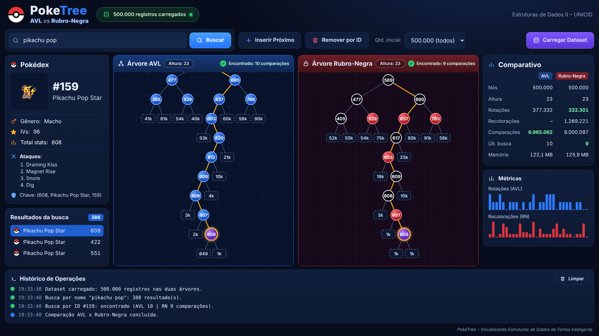

A integridade dos arquivos pode ser conferida com `sha256sum -c SHA256SUMS.txt` dentro de `executaveis/`.

### Passo a passo

**Passo 1 - Extraia o arquivo.** A pasta resultante tem `dataset/`, `LEIAME.txt` e o `poketree` (`poketree.exe` no Windows). Mantenha a pasta `dataset/` ao lado do executável.

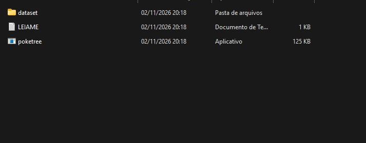

**Passo 2 - Abra o executável.** Windows: dois cliques em `poketree.exe` (se o SmartScreen avisar, "Mais informações" > "Executar assim mesmo"). Linux: `./poketree` no terminal (se der "Permission denied", rode `chmod +x poketree`).

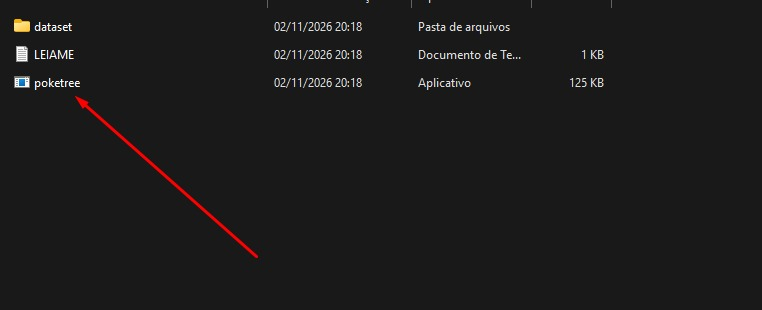

**Passo 3 - Aguarde o carregamento.** Em cerca de 3 s os 500.000 registros são carregados nas duas árvores (AVL e Rubro-Negra) e a janela do app abre. É necessária internet para as imagens dos Pokémon (PokéAPI).

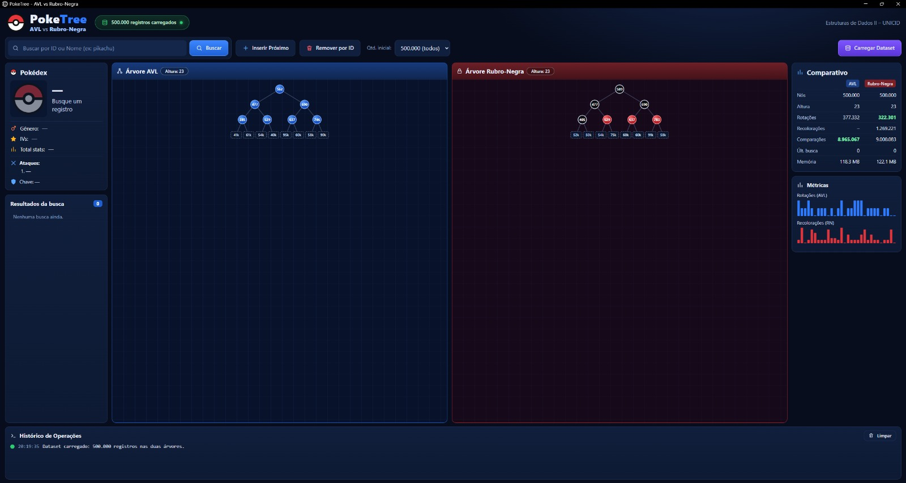

**Passo 4 - Faça uma busca.** Digite um nome (ex.: `pikachu`) ou um ID e clique em **Buscar**. O app mostra o caminho percorrido em cada árvore, o número de comparações, a Pokédex do registro e o comparativo de métricas.

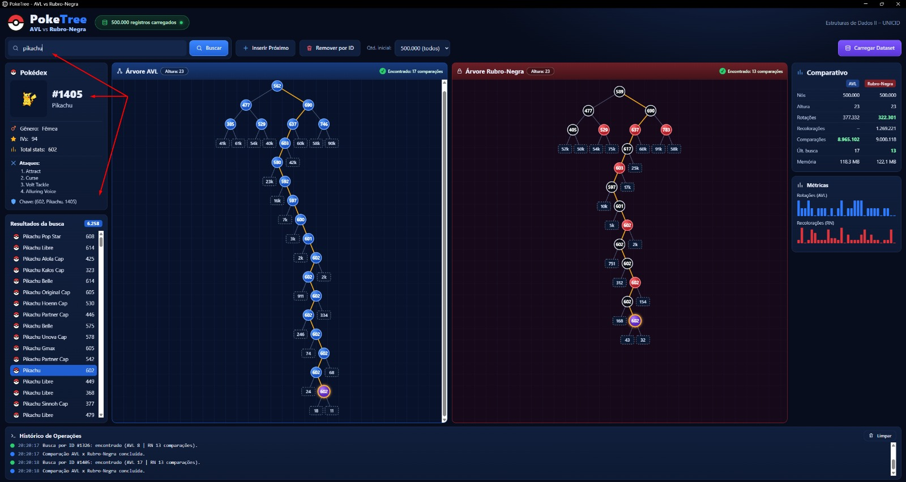

**Passo 5 - Remova um registro.** Com um registro selecionado (ex.: `#1405`), clique em **Remover por ID**. Ele é removido das duas árvores, o contador cai para 499.999 nós e o histórico mostra as rotações/recolorações da operação. Ao buscar o mesmo ID de novo, o app responde "não encontrado" nas duas árvores, com o número de comparações de cada uma.

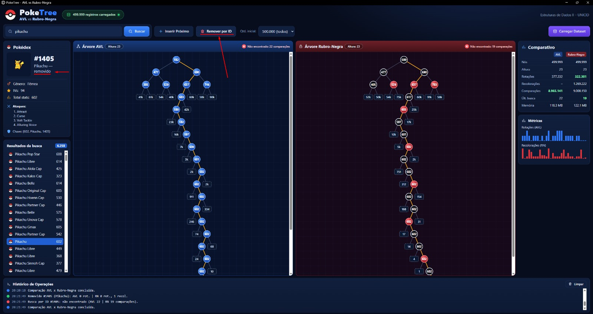

Para encerrar, feche a janela do app (ou `Ctrl+C` no terminal). O servidor roda só localmente em `http://127.0.0.1:8765/`.
